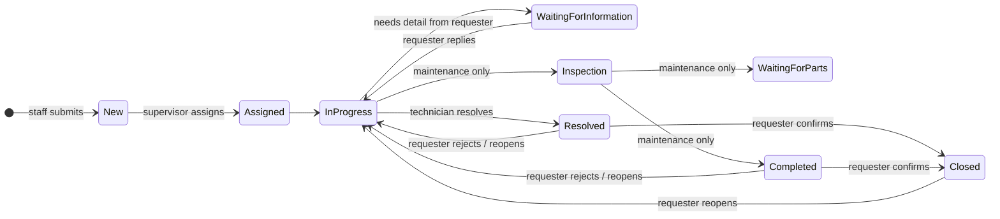
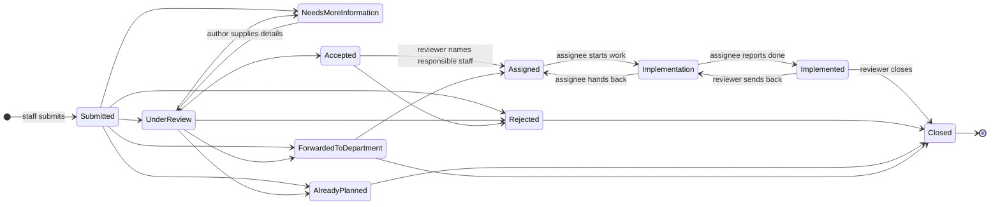
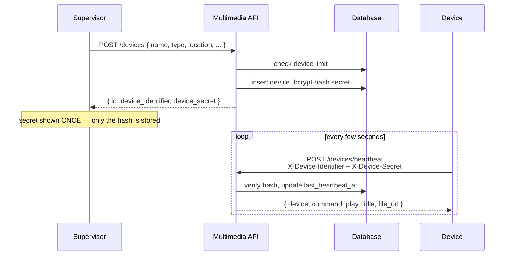
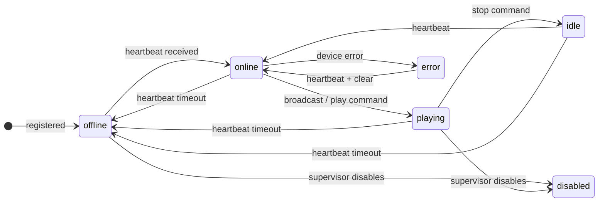

# New Leaf Complex — Business Flow Documentation

This document maps the workflows actually implemented in the API, database and React frontend: the request lifecycle for tickets (IT and Maintenance) and suggestions, how notifications work, the access model, the supporting reference data, and the Multimedia / Digital Signage module.

---

## 1. Access model and actors

| Role | Purpose | Key capabilities |
|---|---|---|
| `staff` | Clinical / non-technical staff | Create IT and maintenance tickets and suggestions; track their own requests; respond when asked for more information; confirm resolution or closure on their own finished tickets. |
| `it_staff` | IT technician | Own the IT queue; view and act on assigned IT tickets; add comments, work notes and attachments; move assigned tickets through technician-allowed statuses. |
| `it_supervisor` | IT lead | Full control of IT tickets (assign, priority, status, workflow); manages multimedia devices and device commands. |
| `maintenance_staff` | Maintenance technician | Same as IT staff, for Maintenance type tickets. |
| `maintenance_supervisor` | Maintenance lead | Full control of maintenance tickets; manages devices, groups, locations and multimedia settings. |
| `admin` | Hospital administrator | Everything admins do, plus driving the suggestion review workflow end to end (triage, assign, close or reject). |
| `sys_admin` | System administrator | Admin rights plus user management, roles, departments, categories, system settings and the activity log. |

All access is enforced server-side: list scoping, detail visibility and action guards. The API is JWT-based (Bearer token); deactivated users cannot log in and their existing tokens are rejected. Login is throttled — 5 failed attempts per email+IP locks that pair for 15 minutes and records a `login_blocked` activity entry.

Access is decided by a small set of shared predicates in `server/src/utils/permissions.js`: `canViewTicket`, `canManageTicket`, `canAssign`, `canControlTicket`, `canViewSuggestion`, `isSuggestionAssignee`, and the role helpers `isTechnician`, `isSupervisor`, `isReviewer`, `isSysAdmin`, `isAdmin`.

---

## 2. Requests, statuses and priorities

| Work type | Route | Number prefix | Handled by |
|---|---|---|---|
| IT ticket | `/api/tickets` with `type=it` | `T-XXXX` | IT staff / supervisor |
| Maintenance ticket | `/api/tickets` with `type=maintenance` | `M-XXXX` | Maintenance staff / supervisor |
| Suggestion | `/api/suggestions` | `S-XXXX` | Author + reviewers (admins) + responsible staff (assignee) |

A ticket's category must belong to its type — a mismatched category is rejected with 400, and any already-parsed upload is deleted before the error is returned.

### 2.1 Ticket lifecycle (IT and Maintenance)

Seeded statuses per type:

- **IT:** New, Assigned, In Progress, Waiting for Information, Resolved, Closed
- **Maintenance:** New, Assigned, Inspection, In Progress, Waiting for Parts, Completed, Closed



1. **Submit.** Staff creates a ticket with type, category and title required; description, location, contact info and equipment name are optional. Priority comes from the seeded levels (Low, Medium, High, Critical) — an invented id is rejected. A number is generated, history records `created`, and the ticket starts as `New`.
2. **Triage and assign.** A supervisor or admin assigns `assigned_to` and moves status toward `Assigned` / `In Progress`. Cross-team assignment, assigning a deactivated user and injecting another type's status are all rejected with 400.
3. **Work.** The technician adds comments, internal work notes (optionally with parts used) and attachments, then advances the status through their team's allowed targets. Resolving requires a resolution description.
4. **Waiting on the requester.** In `Waiting for Information` (IT) or `Waiting for Parts` (Maintenance) the requester is prompted on the detail page; supplying information posts a comment and returns the ticket to `In Progress`.
5. **Resolution.** Once Resolved / Completed, the requester confirms (→ `Closed`) or rejects the resolution (→ `In Progress`, `reopened` history entry, assignee notified). A requester may also reopen a `Closed` ticket to `In Progress`.
6. **Closed** is not terminal in the strict sense — a requester can still reopen it, and a supervisor can move it anywhere their role allows.

### Who may change what

| Actor | Assignment | Priority / title / description / location | Status |
|---|---|---|---|
| Requester (not managing team) | — | — | Only the four requester transitions below |
| `it_staff` / `maintenance_staff` | — | — | Only their team's technician targets, on a ticket assigned to them |
| `it_supervisor` / `maintenance_supervisor` | Yes | Yes | Full control of their team's tickets |
| `admin` / `sys_admin` | Yes | Yes | Full control of all tickets |

Requester transitions (anything else returns 403):

| From | To |
|---|---|
| `Resolved` | `Closed`, `In Progress` |
| `Completed` | `Closed`, `In Progress` |
| `Closed` | `In Progress` |
| `Waiting for Information` | `In Progress` |

Technician workflow guard — technicians move forward only within their own team's status set:

| Type | From | To |
|---|---|---|
| IT | New, Assigned, In Progress, Waiting for Information | In Progress, Waiting for Information, Resolved |
| Maintenance | New, Assigned, Inspection, In Progress, Waiting for Parts | Inspection, In Progress, Waiting for Parts, Completed |

A technician who sends a ticket to `Resolved` or `Completed` without a resolution description gets 400. Moving a ticket back to `In Progress` from Resolved, Completed or Closed clears `resolved_date` and records `reopened`.

### 2.2 Suggestion lifecycle (Improvement)

Seeded statuses: Submitted, Under Review, Accepted, Assigned, Implementation, Implemented, Closed, Rejected, Needs More Information, Already Planned, Forwarded to Department.

Who may move what (server-enforced in `server/src/services/tasks.js`):

| From | Reviewers (admin, sys_admin) | Responsible staff (assignee) | Author |
|---|---|---|---|
| `Submitted` | Under Review, Rejected, Needs More Information, Already Planned, Forwarded to Department | — | — |
| `Under Review` | Accepted, Rejected, Needs More Information, Already Planned, Forwarded to Department | — | — |
| `Accepted` | Assigned, Rejected, Needs More Information | — | — |
| `Assigned` | Implementation, Accepted (unassign) | Implementation | — |
| `Implementation` | Implemented, Assigned | Implemented, Assigned | — |
| `Implemented` | Closed, Implementation | — | — |
| `Needs More Information` | Under Review | — | Under Review |
| `Rejected` | Closed | — | — |
| `Already Planned` | Closed | — | — |
| `Forwarded to Department` | Assigned, Closed | — | — |
| `Closed` | — | — | — |



Consequences of this split:

- **Review decisions stay with the review team.** Assignees cannot accept, reject, close or reassign.
- **Assignees drive delivery.** They can view the suggestion, comment, upload attachments and move `Assigned → Implementation → Implemented/Assigned`.
- **Authors have one narrow transition**: returning a suggestion that was sent back for information to `Under Review`.
- **The API tells each viewer what they may do.** The suggestion detail payload includes `allowed_statuses`, so the frontend never has to duplicate the workflow map — the buttons rendered are exactly the transitions the server will accept.
- **Visibility:** non-admins see their own suggestions; the assigned staff member also gains access once they are assigned. Everyone else gets 403.

---

## 3. Entity-linked notifications

Notifications are addressed to exactly one user. Each may link to the work item it concerns:

- `entity_type` is nullable and only ever `ticket` or `suggestion`
- `entity_id` points at that record
- No foreign key, so a notification stays readable after its target is deleted
- Added by `server/src/database/migrations/20240101000007_notification_task_links.js`, indexed by `notifications_entity_idx`

### 3.1 Endpoints

| Endpoint | Method | Purpose |
|---|---|---|
| `/api/notifications` | GET | Caller's notifications, newest first, capped at 50. |
| `/api/notifications/unread-count` | GET | Unread count for the caller. |
| `/api/notifications/:id` | GET | **Detail.** Returns `{ notification, task }`, where `task` is the full ticket or suggestion payload (description, submitter, dates, priority, status, assignment, attachments, comments, work notes where allowed, complete history). Ownership is the authorization check. If the task was deleted or is no longer viewable, `task` is `null` but the notification is still returned. |
| `/api/notifications/:id/reply` | POST | Reply from the notification. Body `{ comment }` (1–5000 chars). Records a comment on the task, appends `comment_added` to its history, and notifies the other party. Requires an owned notification linked to an existing task. |
| `/api/notifications/:id/read` | PUT | Mark one owned notification as read. |
| `/api/notifications/read-all` | PUT | Mark all owned notifications as read. |

Because a notification belongs to one recipient, reading or answering someone else's notification returns 404 regardless of whether that person can see the underlying task. A notification never widens access.

### 3.2 What raises a notification

**Tickets**

| Event | Who is notified |
|---|---|
| Ticket created | Managing staff for that type (team-scoped fan-out) |
| Ticket assigned or reassigned | The requester, and the new assignee — both entity-linked. Assigning also moves the ticket to `Assigned` automatically and records `assigned` / `reassigned`. |
| Resolved / Completed | The requester, asking them to confirm |
| Waiting for Information | The requester, asking them to comment |
| Progress statuses (In Progress, Inspection, Waiting for Parts, Closed) | The requester, once per status — statuses with a dedicated message above are skipped so nobody is notified twice for the same step |
| Reopened (back to In Progress from Resolved/Completed/Closed) | The assignee, telling them work resumes |
| Requester supplied the requested information | The assignee, telling them to continue |
| Comment added | The other party: requester comments → assignee; staff comments → requester |
| Work notes | Internal to managing staff (recorded in history, never sent to the requester) |

**Suggestions**

| Event | Who is notified | History action |
|---|---|---|
| Suggestion created | Every admin and sys_admin | `created` |
| Status changed | The author, and the assignee (unless they made the change) | `status_changed` |
| Author returns an information-requested suggestion to review | Same as above | `information_provided` — distinguished from an ordinary status change so the timeline shows the requester actually answered |
| Assigned department changed or cleared | The author, with the department name | `assigned_department_changed` |
| Responsible staff set or cleared | The author, and the newly assigned person ("assigned to you") | `assigned_person_changed` |
| Comment added | Author comments → reviewers plus the assignee; reviewer or assignee comments → the author | `comment_added` |

Unlike ticket assignment, a suggestion's responsible staff member only has to be an active user — there is no team-role restriction, because a suggestion can land in any department.

### 3.3 Replier behaviour

`replyToTicket` notifies the counterpart: a requester's reply goes to the assignee, a staff reply goes to the requester. `replyToSuggestion` notifies the author when someone else replies, and fans out to reviewers plus the assignee when the author replies. Both write the comment and history entry first, so the conversation is identical whichever entry point was used.

---

## 4. Collaboration layer: comments, history, attachments, work notes

`server/src/services/collaboration.js` provides one implementation configured per resource (`idField`, `commentsTable`, `historyTable`, `attachmentsTable`) for tickets and suggestions. `server/src/services/tasks.js` layers the shared task behaviour on top: full detail payloads, permission checks, allowed workflow steps, and replies.

| Area | Details |
|---|---|
| Comments | Per task (`ticket_comments`, `suggestion_comments`): user, text (max 5000 for tickets, 2000 for suggestions), timestamp, with the author's name resolved on read. |
| History | Chronological timeline (`ticket_history`, `suggestion_history`): action, old value, new value, actor, timestamp. Actions include `created`, `assigned`, `assigned_department_changed`, `assigned_person_changed`, `status_changed`, `priority_changed`, `comment_added`, `attachment_added`, `attachment_removed`, `information_provided`, `work_notes_added`, `resolved`, `completed`, `reopened`, `closed`, `rejected`. |
| Attachments | Stored per task with original filename, stored path, MIME type and size. Authorization is checked **before** Multer writes anything to disk. Downloads go through authenticated routes only — there is no public `/uploads` mount. |
| Work notes (tickets only) | Internal to the managing team: notes (required, max 5000 chars), optional parts used, author, timestamp. Returned empty for anyone who cannot manage the ticket, and writing one requires that same permission. |

Attachment permissions differ slightly by resource:

| Resource | Upload | Download | Delete |
|---|---|---|---|
| Ticket | Managing team or the requester | Anyone who can view the ticket | Managing team or the requester |
| Suggestion | Author, assignee or reviewers | Anyone who can view it | Author or reviewers |

File handling: allow-listed extensions and MIME checks, 10 MB per file, up to 5 files per upload. SVG is deliberately excluded from inline preview because an SVG can carry script that would execute when rendered in a tab.

---

## 5. Payload shapes

### Ticket detail — `GET /api/tickets/:id`

```jsonc
{
  "ticket": {
    // base ticket columns plus:
    "requester_name": "…", "requester_email": "…", "requester_phone": "…",
    "department_name": "…", "category_name": "…",
    "priority_name": "High", "priority_level": 3,
    "status_name": "In Progress", "assignee_name": "…"
  },
  "comments":    [{ "id": 1, "user_id": 2, "user_name": "…", "comment": "…", "created_at": "…" }],
  "attachments": [{ "id": 1, "file_name": "…", "mime_type": "…", "size": 1, "created_at": "…" }],
  "history":     [{ "id": 1, "user_id": 2, "user_name": "…", "action": "status_changed", "old_value": "New", "new_value": "In Progress", "created_at": "…" }],
  "statuses":    [{ "id": 1, "name": "New", "type": "it", "sort_order": 0 }],
  "workNotes":   []            // populated only for staff who can manage the ticket
}
```

### Suggestion detail — `GET /api/suggestions/:id`

```jsonc
{
  "suggestion": {
    // base suggestion columns plus:
    "user_name": "…", "user_email": "…", "department_name": "…",
    "assigned_department_name": "…", "assignee_name": "…",
    "allowed_statuses": ["Implementation"]   // the steps this viewer may apply
  },
  "comments": [], "attachments": [], "history": [], "statuses": []
}
```

### Notification detail — `GET /api/notifications/:id`

```jsonc
{
  "notification": {
    "id": 1, "user_id": 7, "title": "…", "message": "…", "is_read": false,
    "entity_type": "ticket",        // "ticket" | "suggestion" | null
    "entity_id": 12,                // number | null
    "created_at": "…", "updated_at": "…"
  },
  "task": { /* the ticket or suggestion payload above */ }
}
```

`task` is `null` when the notification has no link, when the target was deleted, or when the recipient may no longer view it.

---

## 6. Frontend flows

### 6.0 Route map and who can reach it

All routes sit behind a protected layout; role-restricted routes render an access error for anyone else. The landing page redirects by role (`getHomeRoute()`). Section 11 covers the Multimedia module in full.

| Route | Who |
|---|---|
| `/dashboard` | any signed-in user (staff home) |
| `/submit-it`, `/submit-maintenance`, `/submit-suggestion` | any signed-in user |
| `/my-requests`, `/profile`, `/notifications`, `/notifications/:id` | any signed-in user |
| `/it`, `/it/tickets`, `/it/my-assigned`, `/it/tickets/:id` | IT staff, IT supervisor, admin, sys_admin |
| `/maintenance`, `/maintenance/tickets`, `/maintenance/my-assigned`, `/maintenance/tickets/:id` | Maintenance staff, Maintenance supervisor, admin, sys_admin |
| `/admin`, `/admin/all-requests`, `/admin/suggestions`, `/admin/reports` | admin, sys_admin |
| `/admin/users`, `/admin/departments`, `/admin/categories`, `/admin/settings`, `/admin/activity-log` | sys_admin |
| `/suggestions/:id` | author, assignee, reviewers (server-checked; the route is not role-gated because visibility is per-record) |
| `/multimedia/*` (dashboard, devices, broadcast, media, groups, locations, schedules, history) | IT staff, IT supervisor, admin, sys_admin |
| `/multimedia/commands`, `/multimedia/settings` | IT supervisor, admin, sys_admin |

Note that `/suggestions/:id` and `/admin/suggestions` render the same component: the page reads the record's permissions and shows the reviewer panel, the assignee progress panel or the author information panel as appropriate.

### 6.1 Notifications

- **List (`/notifications`)** — the 50 most recent, newest first, with unread count, "Mark all as read", and a per-item "Mark read". Every row is a link into the detail page, so a notification is always actionable rather than informational.
- **Detail (`/notifications/:id`)** — the notification card (title, message, time), a compact but complete task summary, attachments, the reply box, and the full history timeline. Opening the page marks the notification read on the server. If there is no task, the page says so plainly instead of showing an error. A button jumps to the task's own page for the full toolset (status controls, work notes, review decisions).
- Replies post to `/notifications/:id/reply` and then reload, so the conversation and history stay consistent with the task page.

### 6.2 My Requests (`/my-requests`)

A combined, filterable view of everything the caller has submitted — tickets and suggestions, newest first.

- Tabs: All, IT Requests, Maintenance, Suggestions (each with its own title)
- Stage filters with live counts: All stages, In progress, Waiting on me, Finished

  | Filter | Includes |
  |---|---|
  | Waiting on me | `Waiting for Information`, `Waiting for Parts`, `Needs More Information` |
  | Finished | `Resolved`, `Completed`, `Closed` |
  | In progress | everything else |

- Columns: number, title, category, location, priority, status, **Handled By** (assignee, or "Not yet assigned"), date, actions
- Actions surface exactly what is outstanding for that record: **Confirm resolution / completion** for a ticket in `Resolved` / `Completed`, and **Provide info** for a suggestion in `Needs More Information`
- A footer note points to notifications, where every assignment, reply and status change arrives

### 6.3 Task detail pages

- **IT Ticket Detail (`/it/tickets/:id`)** and **Maintenance Ticket Detail (`/maintenance/tickets/:id`)** — full ticket context (requester, department, category and equipment, submitted / resolved / closed dates, assignee, location and contact, description, resolution notes), internal work notes for managing staff, attachments, comments, and the history timeline. Status, assignment, priority and work notes are managed through tabbed controls scoped to the viewer's role.
- **Suggestions Review (`/suggestions/:id`, and `/admin/suggestions` for admins)** — adapts to who is looking:
  - reviewers get the full decision panel and department / responsible-staff assignment
  - the assignee gets an "Update Progress" panel with only their allowed steps, plus comments and uploads
  - the author gets the "Provide information" panel when information is requested
  - attachments are visible to everyone involved; only the author or reviewers may remove them

### 6.4 Shared components

- `TaskTimeline` — vertical history with humanized action labels, old → new transitions, quoted excerpts for comments and work notes, and a safe fallback for any action it does not recognise. Used by the ticket pages, the suggestion page and the notification detail page, so a request's history reads the same everywhere.
- `CommentThread` — the conversation plus a controlled reply form (single-line or multiline). The caller owns submission, because a reply from a task page and a reply from a notification are different endpoints that converge on the same stored comment.

---

## 7. Reference data

| Set | Values |
|---|---|
| Roles | staff, it_staff, it_supervisor, maintenance_staff, maintenance_supervisor, admin, sys_admin |
| Priorities | Low (1), Medium (2), High (3), Critical (4) |
| IT statuses | New, Assigned, In Progress, Waiting for Information, Resolved, Closed |
| Maintenance statuses | New, Assigned, Inspection, In Progress, Waiting for Parts, Completed, Closed |
| Suggestion statuses | Submitted, Under Review, Accepted, Assigned, Implementation, Implemented, Closed, Rejected, Needs More Information, Already Planned, Forwarded to Department |

Departments (seeded): Administration, IT Department, Maintenance, Nursing, Laboratory, Pharmacy, Radiology, Emergency, Surgery, Outpatient.

Categories are typed, and a ticket must use a category of its own type:

| Type | Seeded categories |
|---|---|
| IT | Computer, Printer, Network, Internet, Email, Hospital Software, User Account, Password, Telephone, Hardware, Software, Other |
| Maintenance | Plumbing, Electrical, Furniture, Air Conditioning, Building, Medical Equipment, Water, Door/Window, Lighting, Generator, Other |

Roles, departments, categories, priorities, statuses and system settings are all reference data that `sys_admin` manages through the admin API — they are data, not code, so the status sets and category lists above are the current seeded baseline rather than a hardcoded constraint.

---

## 8. Security and integrity

- **Authorization before I/O** — attachment endpoints verify access before Multer parses or stores anything, so an unauthorized upload never touches disk.
- **Attachments are never public** — served only through authenticated download routes; SVG excluded from inline preview.
- **IDOR protection** — notification access is strictly by `(id, user_id)`; ticket visibility respects role and team scoping; suggestion visibility is limited to author, assignee and reviewers.
- **Input validation** — express-validator on create, update and reply endpoints: enum and integer checks, length bounds, and category / status / assignee existence and type. Empty or over-limit replies return 400.
- **Login protection** — five failed attempts per email+IP locks for 15 minutes; failures are logged without a user id, blocks are logged with the address.
- **Activity log** — login, logout and key administrative actions recorded for `sys_admin` review.
- **Configuration** — production refuses to start without an explicit `JWT_SECRET`; `CORS_ORIGIN` accepts a comma-separated allowlist; uploads live outside the served static root.

---

## 9. Test coverage

The API suite (`server/test`, 206 tests across 10 files) pins the behaviour described above:

| Suite | What it protects |
|---|---|
| `auth.test.js` | Login, lockout, password change, deactivated accounts |
| `rbac.test.js` | Role-based list scoping and action guards across every module |
| `workflows.test.js` | Ticket and suggestion transitions, assignee boundaries, requester actions |
| `security.test.js` | IDOR attempts, attachment authorization, validation limits |
| `notificationTasks.test.js` | Entity linking, notification detail payloads, replies, assignee fan-out |
| `dashboard.test.js` | Role-scoped statistics |
| `multimedia.test.js` | Device registration, heartbeat, broadcast, scheduling, command queue |
| `invariants.test.js` | Cross-cutting database and API invariants |
| `characterization.test.js` | Locked-in behaviour of long-standing endpoints |
| `contract.test.js` | Response envelopes and snapshots |

Contract note: the suggestion detail envelope deliberately includes `allowed_statuses`. Snapshot and contract expectations are updated with `npm run test:regression:update` when an envelope change is intended.

---

## 10. End-to-end example: a suggestion reaching closure

1. **Staff submits.** `POST /api/suggestions` creates `S-0001` in `Submitted`, records `created` in history, and notifies admins and sys_admins with `entity_type='suggestion'`.
2. **Review.** An admin moves it to `Under Review`, then `Accepted`, then assigns responsible staff and marks it `Assigned`. Each step writes history and notifies the author; the assignee receives an entity-linked "assigned to you" notification.
3. **The assignee opens the notification.** `GET /api/notifications/:id` returns the complete suggestion — problem statement, submitter, department, dates, assignment, attachments, comments and history — along with `allowed_statuses: ["Implementation"]`. Opening it marks the notification read.
4. **Conversation.** The assignee replies from the notification; the reply is stored as a comment, appended to the history as `comment_added`, and notifies the author and reviewers.
5. **Delivery.** The assignee moves `Assigned → Implementation → Implemented`. Each move notifies the author. Closing is a review decision and remains unavailable to the assignee.
6. **The requester follows along.** Every step appears in their notifications, in the history timeline, and on their `/my-requests` list under the stage filters.

The ticket flow is the same shape with a wider set of actors: submit, assign, work with internal notes, request information from the requester, resolve, and let the requester confirm or reopen.

---

## 11. Multimedia Control & Digital Signage

A separate module for pushing content to hospital TVs and media players. It is independent of the ticket workflow: no request is ever created for it, and it is not visible to `staff` or either maintenance role. It lives in `server/src/routes/multimedia.js` (53 endpoints), `server/src/services/multimediaDeviceService.js` (the model), and the `client/src/pages/multimedia/` screens.

### 11.1 The management model in one picture

The design goal is that **a broadcast is always a statement about delivery, never an assumption.** A screen that is offline is reported as offline. A command the player cannot perform is reported as unsupported. Nothing is optimistically marked as playing.

Five entities, and the whole module is their interaction:

| Entity | Role in the model |
|---|---|
| **Location** | A tree of campus → building → floor → ward → location → room. Purely organisational; it does not affect delivery. |
| **Device** | A registered TV / display / media player. Holds a `device_identifier` and a bcrypt-hashed one-time secret, a heartbeat timestamp, a live `status`, and what it is playing right now. |
| **Group** | A named, reusable set of devices (many-to-many). Exists so a broadcast can target "all waiting areas" rather than 40 device ids. |
| **Media asset** | An uploaded image or video with metadata and a lifecycle status (`draft` / `active` / `archived`). Only `active` assets can be broadcast or scheduled. |
| **Target** | Not a table — a `(target_type, target_id)` pair meaning one device, one group, or all devices. Both broadcasts and schedules address a target. |

```mermaid
flowchart LR
    Loc[Location tree] -.assigned to.-> Dev[Device]
    Grp[Group] ---|membership| Dev
    Media[Media asset<br/>draft / active / archived]
    Sched[Schedule] -.fires-> Broadcast
    Media --> Broadcast[Broadcast]
    Broadcast -->|target| T{Target}
    T --> Dev
    Dev -.heartbeat.-> Srv[Server recomputes status]
    Srv --> Hist[(playback_history)]
    Srv --> Audit[(multimedia_audit)]
    Dev -.command queue.-> Cmd[(device_commands)]
```

### 11.2 Who can do what

Two gates, applied in `multimedia.js`: `requireView` for the whole module and `requireManage` on individual routes.

| Capability | `it_staff` | `it_supervisor` | `admin` | `sys_admin` |
|---|---|---|---|---|
| View dashboard, devices, groups, locations, media, history, capabilities | Yes | Yes | Yes | Yes |
| Upload / edit media, broadcast, stop, create and edit schedules | Yes | Yes | Yes | Yes |
| Register, edit, enable, disable, remove devices | No | Yes | Yes | Yes |
| Manage groups and the location tree | No | Yes | Yes | Yes |
| Change media lifecycle (activate / archive / draft) | No | Yes | Yes | Yes |
| Send a device command | Only if `multimedia_allow_it_staff_commands` is on (default **off**) | Yes | Yes | Yes |
| Redeliver a failed command | No | Yes | Yes | Yes |
| Read / change multimedia settings and the audit log | No | Yes | Yes | Yes |

The `it_staff` command gate is a deliberate default-deny: technicians work on content, supervisors control hardware.

### 11.3 Enrolling a device



1. **Register.** `POST /api/multimedia/devices` requires manage rights. The active-device count is checked against the `multimedia_device_limit` setting (default 100) first. An identifier is either supplied or generated from the name; a duplicate returns 400. The device is created `offline` / `is_active: true`.
2. **One-time secret.** A `nl-dev-<hex>` secret is generated, bcrypt-hashed into `device_secret_hash`, and returned **once** in the registration response. It is never readable again; a supervisor regenerates it with `PUT /devices/:id { regenerate_secret: true }`.
3. **Heartbeat.** `POST /api/multimedia/devices/heartbeat` is registered *before* the JWT middleware, because devices are not users. It authenticates on the identifier plus secret; an unknown identifier or wrong secret is 401, and a disabled device is 403. A successful heartbeat updates `last_heartbeat_at`, flips a stale device to `online`, records `heartbeat_online` in history, and returns the device's capability manifest plus the current instruction — `play` with a media id and file URL, or `idle`.
4. **Disable / remove.** Both set `is_active = false` and `status = 'disabled'`. Removal is a soft removal: the row and its history survive so past broadcasts remain explainable. A disabled device's heartbeats are rejected, and it is excluded from every target resolution.

### 11.4 Presence: how online is computed

There is no background poller. **Online is derived** from `last_heartbeat_at` against the `multimedia_heartbeat_timeout_minutes` setting (default 3, range 1–1440).

`refreshDeviceStatuses()` runs on the dashboard, device list, and the explicit `heartbeat-check` action. For each active device:

- heartbeat older than the timeout → status `offline`, message "No heartbeat for over N minutes", a `heartbeat_offline` history row, and a notification to every manager
- `offline` but now within the timeout → status `online` and a `heartbeat_online` history row

`playing` and `error` are stored hints: a playing device keeps showing `playing` while its heartbeat stays fresh, and a device in `error` is not silently promoted back to online.



### 11.5 Broadcasting

`POST /api/multimedia/broadcast` with `{ media_id, target_type, target_id?, priority? }`.

1. The media must exist and be `active` — a draft or archived asset is 400.
2. `resolveTargetDeviceIds` turns the target into a device list, always filtered to `is_active = true`. No active devices is 400 rather than a silent no-op.
3. Each device is evaluated on heartbeat freshness. Online devices get a `play` command; offline or failed devices are recorded with a reason and counted separately.
4. Successful devices are updated to `playing` with `current_media_id` and a start timestamp.
5. A `playback_assignments` row is written with `devices_total`, `devices_success`, `devices_offline` — the delivery report for this broadcast.
6. Every device attempt is written to `playback_history` with action `broadcast` and status `success` / `failed` / `offline`.
7. The broadcast is written to `multimedia_audit`.
8. If any device was missed, the operator **and** all managers get a "Multimedia playback issue" notification with the success ratio.

`POST /api/multimedia/broadcast/stop` is the same target mechanism: online devices get `stop` and go to `idle` with `current_media_id` cleared; offline devices are recorded as such.

### 11.6 The command layer and its honesty rule

Hardware is abstracted behind `sendDeviceCommand`. The bundled integration is `mock-local-player`:

| Command | Reported |
|---|---|
| `play`, `stop` | `succeeded` — a real delivery is recorded |
| power, volume, mute, reboot, input_source | `not_supported` — never faked as success |

`POST /api/multimedia/devices/:id/command` records **every** attempt in `device_commands` and returns a `command_id`, including the failures:

- unsupported command → row written as `not_supported`, 400 returned
- device offline → row written as `failed` with "Device offline", playback history records `offline`, 400 returned
- supported and online → row written as `succeeded`, device status updated, playback history records `success`

Supervisors can `POST /api/multimedia/commands/:id/redeliver` to retry a failed command; it re-runs every check and updates the same row, so the queue shows the retry rather than a duplicate entry. `GET /api/multimedia/commands` and `GET /devices/:id/commands` expose the queue with the requester and result.

`GET /api/multimedia/capabilities` publishes the whole manifest to the UI — integration name, supported commands, accepted file types, statuses, target types, repeat types, and the explicit phase-2 limitations — so the frontend renders exactly what the backend can do.

### 11.7 Media library

Upload accepts png, jpg, webp, mp4 and webm, up to 100 MB, with a MIME allow-list. A rejected or oversized file is deleted from disk rather than orphaned, and a failed title validation also removes the just-written file.

| Operation | Who | Notes |
|---|---|---|
| List / view / stream | View roles | Search by title, tags, description; filter by status and category; paginated with a total. Files are streamed through an authenticated route, not served from a public path. |
| Upload | View roles | Created as `active`; the uploader is recorded. |
| Edit metadata / replace file | View roles | Replacing a file deletes the old file from disk. |
| `activate` / `archive` / `draft` | Manage roles | Only `active` media can be broadcast or scheduled. |
| Delete | Manage roles | Archiving, not a hard delete — refused while the asset is in an active playback assignment, and kept afterwards so history stays intact. |

### 11.8 Scheduling

`scheduled_playbacks` stores a media asset, a target, a start (and optional end), a repeat rule and a priority (0 normal, 1 high, 2 emergency).

| Repeat type | Fires |
|---|---|
| `none` | Once, then the schedule is marked `ended` |
| `daily` | Once per calendar day after the first run |
| `weekly` | Every 7 days from the first run |
| `specific_days` | On the listed weekdays (`0` = Sunday, comma-separated) |

An honest limitation, documented in the service: **there is no background worker.** Due schedules are processed when the system is asked to — on a dashboard or history read, or via the explicit `POST /api/multimedia/schedules/process` action. Each due schedule calls the same `performBroadcast` used by a manual broadcast (so it produces the same assignment, history and offline reporting), then stamps `last_run_at`. A schedule that throws is recorded as a failed `schedule_start` rather than blocking the others. Schedules can be paused, resumed and ended.

### 11.9 History, audit and settings

- **`playback_history`** is the per-device delivery trail: action (`broadcast`, `stop`, `schedule_start`, `play`, `heartbeat_online`, `heartbeat_offline`), status, who triggered it, and any error. Filterable by device, media, action and status; paginated.
- **`multimedia_audit`** records every administrative action — device register / update / enable / disable / remove / secret regeneration, group and location changes, media upload / update / lifecycle / archive, broadcast, stop, schedule create / update / pause / resume / end / delete, command sent / failed / not supported / redelivered, and setting changes — with the actor, entity and a JSON detail blob. Filterable by entity type.
- **Settings** live in `system_settings` under the `multimedia` category, and only the three known keys are writable:

  | Key | Default | Range |
  |---|---|---|
  | `multimedia_heartbeat_timeout_minutes` | 3 | 1–1440 |
  | `multimedia_device_limit` | 100 | 1–100000 |
  | `multimedia_allow_it_staff_commands` | false | true / false |

### 11.10 Frontend screens

| Screen | Route | Purpose |
|---|---|---|
| Dashboard | `/multimedia` | Totals, recent activity, a "needs attention" list of error and offline devices. Reading it refreshes device presence and runs due schedules. |
| Devices | `/multimedia/devices`, `/multimedia/devices/:id` | Register, filter, search, enable/disable, edit, view groups and capabilities, per-device command log. |
| Broadcast | `/multimedia/broadcast` | Pick media and a target, broadcast or stop, see the per-device delivery result. |
| Media Library | `/multimedia/media` | Upload, search, filter, preview, edit, and change lifecycle status. |
| Groups | `/multimedia/groups` | Create groups and manage membership. |
| Locations | `/multimedia/locations` | Maintain the location tree; deletion is refused while children or devices exist. |
| Schedules | `/multimedia/schedules` | Create, pause, resume, end, delete, and manually process due schedules. |
| History | `/multimedia/history` | The delivery audit trail. |
| Device Commands | `/multimedia/commands` | Supervisor-only command queue with redelivery. |
| Settings & Audit | `/multimedia/settings` | Supervisor-only settings and the audit log. |

Shared presentation lives in `client/src/pages/multimedia/multimediaHelpers.js`: status→colour maps for devices, playback results and media, plus date and byte formatting.

### 11.11 Design decisions worth knowing

- **Honest reporting over convenience.** Offline devices, unsupported commands and partial broadcasts are surfaced as such, because a signage system that silently claims success is worse than one that admits a screen is dark.
- **No background jobs.** Both presence and scheduling are pull-based. Simple to run and reason about; a long-lived deployment would want a worker for schedule accuracy.
- **Soft device removal.** Devices are disabled, never deleted, so past playback history remains meaningful.
- **Media is archived, not destroyed**, and only `active` assets can go on air — an operator can never accidentally broadcast a draft.
- **One integration, one manifest.** A real hardware driver replaces `sendDeviceCommand` and the capability list; the routes and UI already read that manifest, so nothing above the abstraction needs to change.

---

*This document reflects the implemented behaviour, not an intended future state; the suite, lint and build were all green when it was written.*
